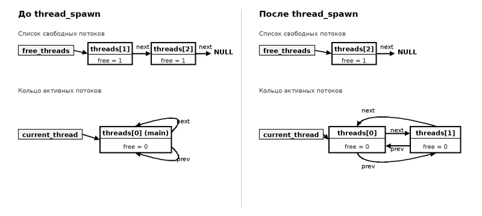
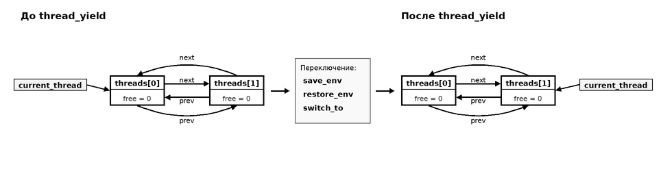
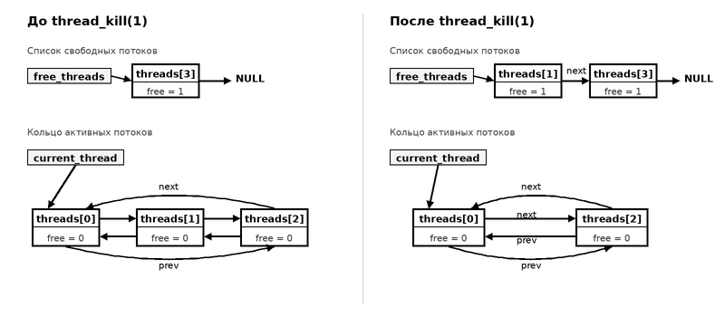
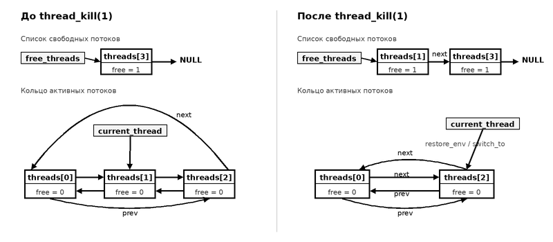

####################
 Реализация потоков
####################

Данная реализация использует зеленые потоки, то есть кооперативную
многозадачность. Потоки должны передавать управление на другие потоки в
местах указанных программистом. Завершение главного потока - выход из
программы.

**************************
 Модуль потоков threads.c
**************************

Этот модуль инициализирует подсистему потоков и реализует программный
интерфейс для работы с потоками. Потоки хранятся в массиве threads,
размером MAX_THREADS. Сначала при добавлении потоков массив заполняется
последовательно, затем используется список свободных ячеек. Главный
(основной) поток тоже должен быть инициализирован.

********************
 Интерпретатор Лисп
********************

Основу интерпретатора составляет функция eval, которая выполняет
заданное выражение (параметр obj) в заданном окружении переменных
(параметр env). Она обходит дерево выражения и выполняет каждое
подвыражение. Параметрами вычислений являются:

-  текущее окружение перенных (current_env);
-  текущее окружение функций (func_env);
-  стек для tagbody (два окружения в каждом кадре стека);
-  стек для catch (два окружения и метка в каждом кадре стека);
-  стек защищенных объектов (protected).

Каждый поток должен хранить эти состояния. Глобальные переменные
доступны всегда для всех потоков, поэтому их не надо учитывать. Также
поток должен хранить выражение, с которого возобновится вычисление,
когда поток вновь получит управление.

.. code:: common-lisp

   (progn 1 2 3 (thread-yield) 4 5 6) ;; при переключении должно сохраниться (progn 4 5 6)
   (progn 1 2 3
      (if (> a 10) (thread-yield) nil)
      4 5 6)  ;; при переключении должно сохраниться (progn 4 5 6)

*****************************
 Переключение между потоками
*****************************

Каждый поток должен хранить свой стек, где будет текущее состояние
интерпретатора, указатель стека (регистр esp/rsp).

Состояние стека при вызове thread-yield:

.. code::

   -------------- Кадр thread-yield
   адрес возврата
   -------------- Предыдущий кадр
   локальные переменные
   EBP/RBP - указатель предыдущего кадра
   адрес возврата
   параметры

ESP/RSP указывает на адрес возврата. EIP/RIP - внутри thread-yield.
EIP/RIP не нужно сохранять, потому что адрес возврата уже хранится в
стеке.

Алгоритм thread-yield:

-  сохранить все параметры интерпретации (которые выше) в структуре
   текущего потока
-  сохранить текущий ESP/RSP в структуре текущего потока
-  сохранить требуемые регистры (как в setjmp)
-  выбрать следующий поток для возобновления (он становится текущим)
-  восстановить параметры интерпретации из структуры нового текущего
   потока
-  восстановить регистры
-  восстановить ESP/RSP

После выхода из thread-yield, управление попадает в точку после вызова
thread-yield другого потока.

**************************************
 Организация планировщика и управление
**************************************

Планировщик многозадачности построен на основе кольцевой очереди активных потоков
и пула свободных потоков поверх статического массива.

Хранение свободных и активных потоков
=====================================

Структуры потоков размещаются в фиксированном массиве ``threads[MAX_THREADS]``,
где ``MAX_THREADS = 64``. В подсистеме организованы две структуры данных:

* **Стек свободных потоков (free_threads):** неиспользуемые слоты объединены в односвязный
  LIFO-стек через указатель ``free_threads`` и поле связи ``next``. Для свободных потоков
  указатель ``prev`` обнулен (``NULL``), а флаг ``free`` равен единице.
* **Кольцевой список активных потоков (current_thread):** все готовые к исполнению потоки
  связаны в циклический двусвязный список через указатели ``next`` и ``prev``. Глобальный
  указатель ``current_thread`` указывает на структуру потока, выполняющегося на процессоре
  в данный момент. Двусвязный список обеспечивает удаление и добавление потоков
  за константное время :math:`O(1)`.

Инициализация подсистемы
======================================================

Инициализация подсистемы выполняется функцией ``init_threads()`` при старте среды:

* **Создание главного потока:** главный поток размещается в нулевом слоте ``threads[0]``
  и создается по умолчанию. Его указатели ``next`` и ``prev`` замыкаются на самого себя.
  Его невозможно освободить: при попытке вызвать функцию ``thread_kill``
  для нулевой структуры (главного потока ``thread == threads``) планировщик ловит ошибку.
* **Формирование пула свободных слотов:** элементы массива с индексами от 1 до ``MAX_THREADS - 1``
  последовательно связываются через указатели ``next`` в стек свободных ячеек, вершиной
  которого становится ``free_threads = threads + 1``.

Сохранение и восстановление контекста и стека потоков
=====================================================

Для обеспечения бесшовного переключения между задачами каждый поток сохраняет как аппаратное
состояние процессора, так и логический контекст интерпретатора Лисп:

* **Сохранение окружения (save_env):** функция копирует глобальные параметры текущего состояния
  вычислений в структуру текущего потока:

  - ``current_env`` – окружение локальных переменных;
  - ``func_env`` – окружение локальных функций;
  - ``last_protected`` – указатель вершины стека защищенных объектов сборщика мусора;
  - ``tb_index_buf`` – индекс текущего кадра стека переходов ``tagbody``;
  - ``ct_index_buf`` – индекс текущего кадра стека перехватов ``catch``.

* **Восстановление окружения (restore_env):** функция восстанавливает значения перечисленных
  переменных интерпретатора из структуры возобновляемого потока.
* **Аппаратное переключение (switch_to):** низкоуровневая подпрограмма сохраняет регистры и указатель
  стека (ESP/RSP) текущей задачи, после чего переключает процессор на стек целевого потока.

Создание потока (thread_spawn)
==============================

Создание новой задачи реализуется функцией ``thread_spawn``:

1. Из стека ``free_threads`` извлекается свободный слот структуры. Если стек пуст,
   возбуждается ошибка нехватки памяти (``"Error: out of memory: threads"``).
2. Выбранная структура встраивается в активное кольцо непосредственно перед ``current_thread``
   (в конец очереди готовых задач):
   связи ``prev`` текущего потока и ``next`` его предшественника замыкаются на новую структуру.
3. Полю ``function`` присваивается переданный объект функции, обнуляется результат ``result``,
   сбрасывается признак ``free = 0``, и увеличивается счетчик ``total_threads``.
4. Функция возвращает целочисленный идентификатор созданного потока (смещение слота в массиве
   ``thread - threads``) в виде Lisp-числа.

Кооперативная уступка процессора (thread_yield)
===============================================

Функция ``thread_yield`` передает управление следующей задаче в активной очереди:

1. Планировщик выбирает следующий поток по указателю: ``next_thread = current_thread->next``.
2. Если в кольце активных задач остался только один поток (``current_thread == next_thread``),
   переключение не выполняется, и функция немедленно возвращает управление.
3. При наличии других активных потоков сохраняется контекст интерпретатора текущего потока
   (``save_env``), загружается контекст целевого потока (``restore_env``), выполняется аппаратное
   переключение стеков (``switch_to``), и указатель ``current_thread`` обновляется на выбранный поток.

Освобождение неактивного потока
===============================

Завершение потока, который не является выполняющимся в данный момент,
выполняется функцией ``thread_kill`` без переключения контекста:

1. Целевой поток извлекается из активного кольца за время :math:`O(1)`: соседние потоки
   напрямую соединяются друг с другом (``thread->prev->next = thread->next; thread->next->prev = thread->prev;``).
2. Освобожденный поток помещается на вершину стека свободных слотов ``free_threads``:
   указатель ``next`` направляется на прежнюю вершину, указатель ``prev`` обнуляется,
   а ``free_threads`` начинает указывать на освобожденный поток.
3. Флаг слота устанавливается в ``free = 1``, сбрасывается сохраненный результат (``result = 0``),
   и уменьшается общий счетчик активных потоков ``total_threads``.
4. Текущий исполняемый поток ``current_thread`` продолжает свою непрерывную работу.

Освобождение активного потока
=============================

Если завершается поток, выполняющийся на процессоре в данный момент, процедура освобождения
дополняется обязательным переключением на следующую задачу:

1. Выполняющийся поток исключается из двусвязного активного кольца и возвращается в стек
   свободных ячеек ``free_threads`` по тем же правилам, что и неактивный поток.
2. Поскольку текущий контекст уничтожается, планировщик не может вернуть в него управление.
   Вместо этого он загружает переменные интерпретатора следующего активного потока
   (``restore_env(next_thread)``), восстанавливает его стек
   (``switch_to(current_thread, next_thread)``) и обновляет глобальный указатель
   ``current_thread = next_thread``.

